

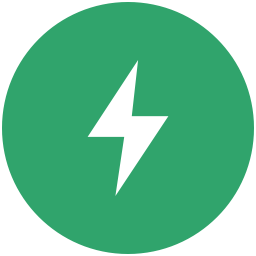

# DeyeWatch

**Сповіщення про відключення світла та аналітика для гібридних інверторів Deye**

Дізнавайтеся про зникнення й появу світла за 10–20 секунд, бачте, на скільки вистачить батареї,
і майте повну статистику відключень, якості мережі та енергії — без хмари й без підписок.

[**Сайт продукту**](https://purikv.github.io/DeyeWatch/) ·
[Завантажити](https://github.com/purikv/DeyeWatch/releases/latest) ·
[Встановлення](docs/installation.md) ·
[Посібник](docs/user-guide.md) ·
[Питання й проблеми](docs/troubleshooting.md)

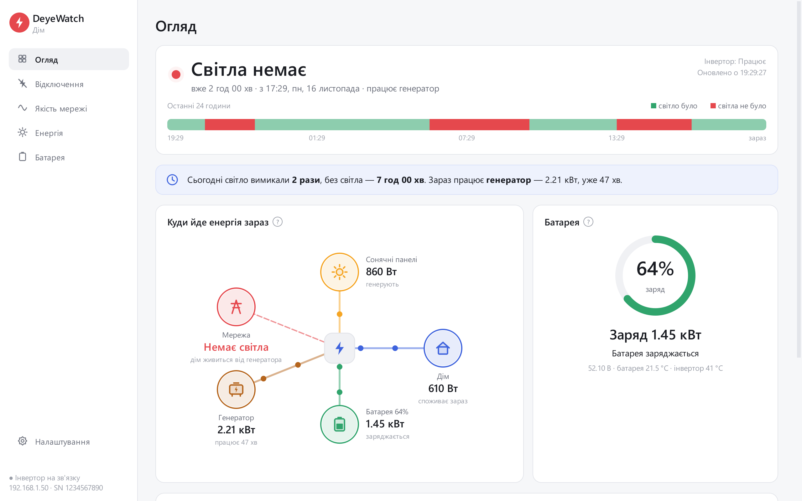

---

## Можливості

| | |
|---|---|
| ⚡ **Миттєві сповіщення** | «Світло зникло / з'явилося», низький заряд батареї, напруга поза нормою, запуск і зупинка генератора, втрата зв'язку з інвертором. На робочому столі — власні акуратні картки, за бажанням — у Telegram вам і рідним. |
| 🔀 **Схема потоків енергії** | Наочно видно, звідки береться електрика (мережа, сонце, генератор, батарея) і куди йде — з потужністю й анімацією напрямку. |
| 🔋 **Прогноз батареї** | «Вистачить на ≈ 7 год 40 хв» при поточному споживанні — до мінімального заряду, після якого інвертор вимикається. |
| 📊 **Статистика відключень** | Кількість, сумарна, найдовша й середня тривалість, години без світла по днях і **теплова карта** «коли найчастіше вимикають». |
| 〰️ **Якість мережі** | Напруга (середнє, мінімум, максимум) зі смугою норми 207–253 В, частота, журнал подій. |
| ☀️ **Енергія** | Вироблено сонцем і генератором, спожито, куплено й продано по днях, рівень самозабезпечення. |
| ☁️ **Deye Cloud (опційно)** | Поки комп'ютер вимкнений чи спить, дані збирає хмара Deye — програма сама догружає пропущене. |
| 🔒 **Локально й приватно** | Дані беруться напряму з WiFi-стіка у вашій мережі. Історія зберігається лише на вашому комп'ютері. |

Кожен розділ аналітики та кожен тип сповіщень вмикається окремо. Світла й темна теми, підказки до
кожного показника, автопошук стіка в мережі, перенесення налаштувань між комп'ютерами.

## Скріншоти

<table>
<tr>
<td width="50%">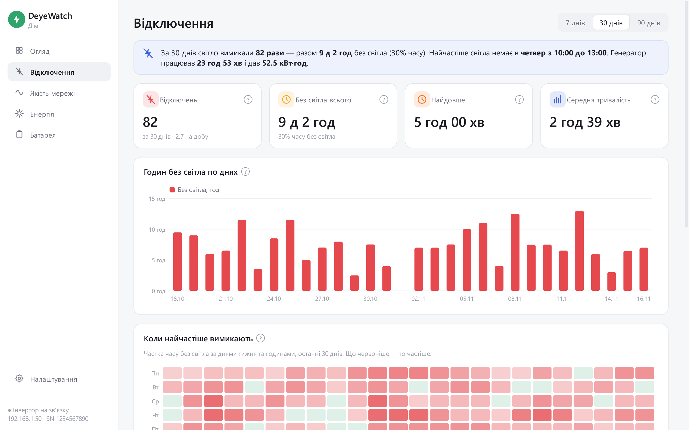 <b>Відключення</b> — підсумок людською мовою, графік по днях, теплова карта</td>
<td width="50%">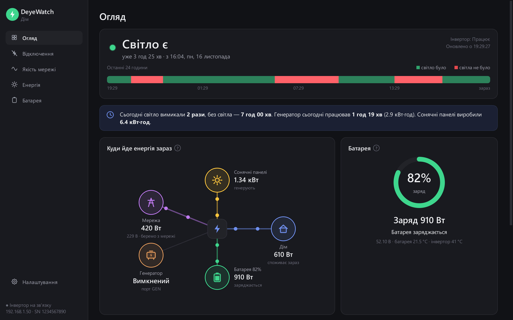 <b>Огляд</b> у темній темі — світло є, сонце заряджає батарею</td>
</tr>
<tr>
<td>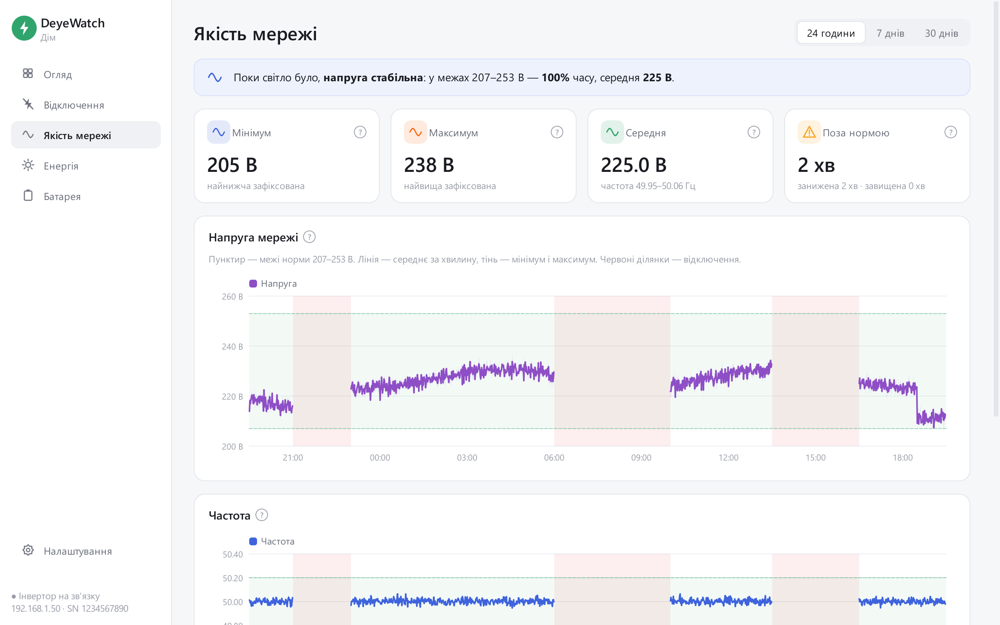 <b>Якість мережі</b> — напруга й частота з межами норми</td>
<td>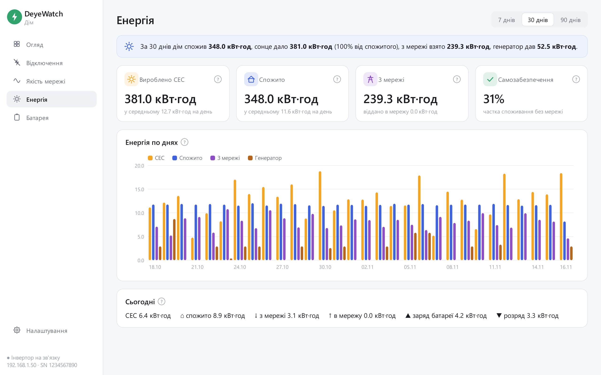 <b>Енергія</b> — сонце, споживання, мережа й генератор по днях</td>
</tr>
<tr>
<td>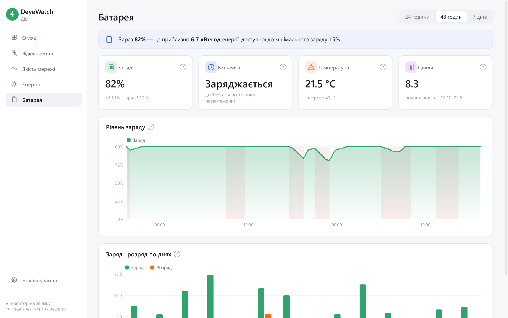 <b>Батарея</b> — рівень заряду, прогноз, температура, цикли</td>
<td>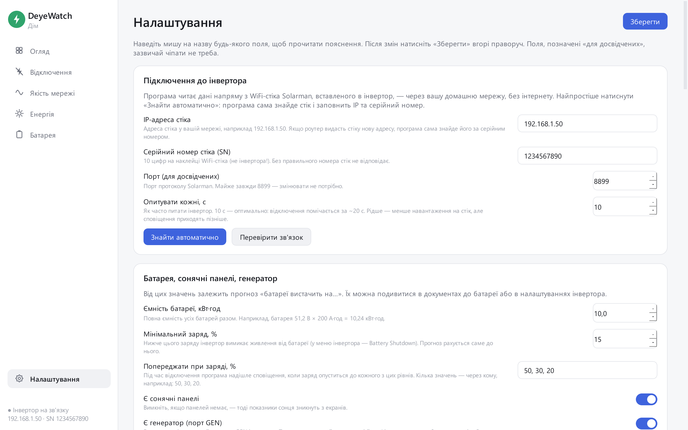 <b>Налаштування</b> — пояснення до кожного поля</td>
</tr>
</table>

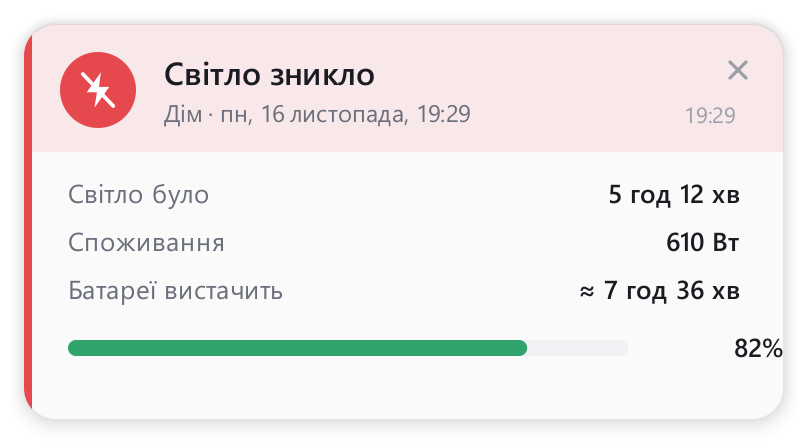
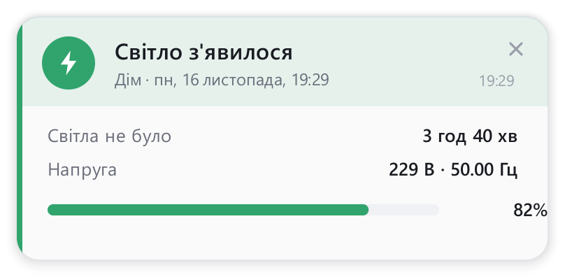
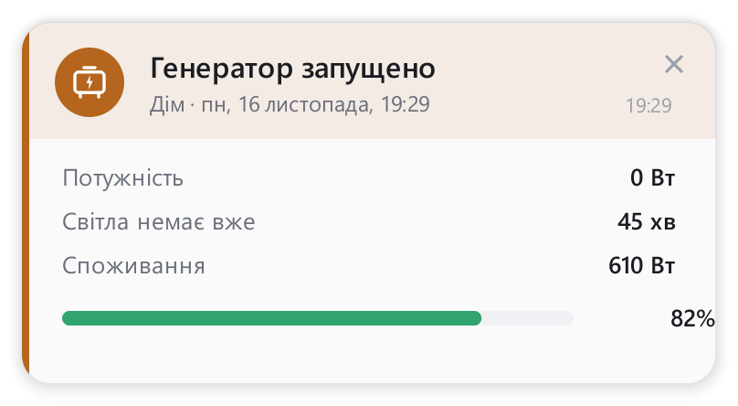

## Швидкий старт

1. **Завантажте** програму для своєї системи з [останнього релізу](https://github.com/purikv/DeyeWatch/releases/latest):

   | Система | Файл | Встановлення |
   |---|---|---|
   | Windows 10 / 11 (64-біт) | `DeyeWatch.exe` | не потрібне — просто запустіть |
   | Ubuntu 22.04+, Debian 11+, Linux Mint 21+ | `deyewatch_amd64.deb` | `sudo apt install ./deyewatch_amd64.deb` |
   | Інші Linux (Fedora, Arch, ARM64…) | `DeyeWatch-linux.tar.gz` | `sh install.sh` |

2. **Запустіть.** Програма сама знайде WiFi-стік інвертора у вашій мережі. Якщо ні — у
   *Налаштуваннях* натисніть **«Знайти автоматично»** або впишіть IP і серійний номер стіка.
3. **Пройдіть картку «З чого почати»** на Огляді: батарея, автозапуск, за бажанням Telegram і Deye Cloud.

Детально — у [посібнику зі встановлення](docs/installation.md).

## Сумісність

| | |
|---|---|
| **Інвертори** | Однофазні гібридні Deye серій SUN-…-SG0xLP1 (перевірено на **SUN-6K-SG03LP1**). Моделі Sunsynk і Sol-Ark з тією ж картою регістрів, імовірно, теж працюють, але не перевірялися. |
| **Зв'язок** | WiFi-стік Solarman, що відповідає на локальному порту **8899** (протокол Solarman V5). Комп'ютер і стік мають бути в одній мережі. |
| **Генератор** | Підключений до порту **GEN** інвертора. Генератор на вході GRID інвертор не відрізняє від мережі. |

## Документація

| Розділ | Про що |
|---|---|
| [Встановлення](docs/installation.md) | Windows, Linux (.deb, архів), запуск із сирців, автозапуск, оновлення, видалення |
| [Посібник користувача](docs/user-guide.md) | Усі екрани й сповіщення: що показують і як читати |
| [Налаштування](docs/settings.md) | Довідник усіх параметрів, перенесення на інший комп'ютер |
| [Deye Cloud](docs/deye-cloud.md) | Як отримати App ID / App Secret і догружати історію |
| [Telegram](docs/telegram.md) | Бот, отримувачі, команди `/status` і `/stats` |
| [Питання й проблеми](docs/troubleshooting.md) | Стік не знаходиться, немає трею, автозапуск, хибні сповіщення… |
| [Як це працює](docs/how-it-works.md) | Протокол, регістри, визначення відключень, зберігання даних, приватність |
| [Розробка](docs/development.md) | Структура коду, збірка .exe і .deb, скріншоти |
| [Бот для роутера](router-bot/README.md) | Легка версія без інтерфейсу — цілодобово на роутері ASUS (Merlin + Entware) |

## Приватність

DeyeWatch не має власного сервера й нічого не надсилає розробнику. Дані йдуть лише туди, куди ви
самі вкажете: з WiFi-стіка у вашій мережі — на ваш комп'ютер; за бажанням — у **ваш** Telegram-бот і
з **вашого** акаунта Deye Cloud. Токени й ключі зберігаються локально у файлі налаштувань; пароль
Deye Cloud — лише у вигляді хешу SHA-256, як того вимагає API Deye.

## Ліцензія

[MIT](LICENSE). Вбудована бібліотека Qt for Python (PySide6) поширюється за ліцензією LGPLv3.
Карту регістрів інвертора взято з проєкту
[StephanJoubert/home_assistant_solarman](https://github.com/StephanJoubert/home_assistant_solarman).
Deye, Solarman, Sunsynk і Sol-Ark — торговельні марки відповідних власників; проєкт із ними не пов'язаний.
