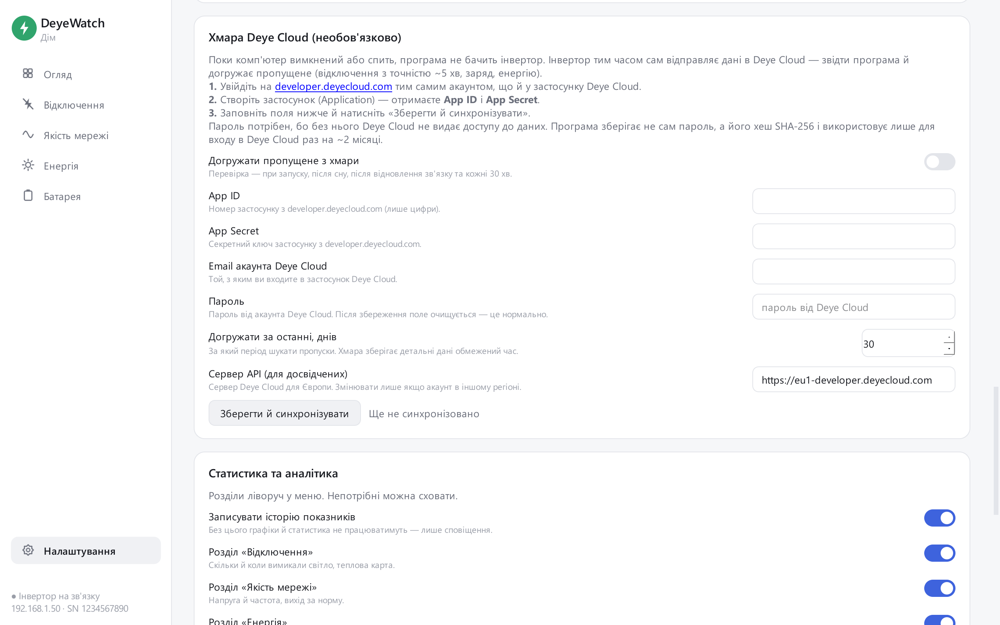

# Deye Cloud: історія за час, коли програма не працювала

[← До README](../README.md)

Поки комп'ютер вимкнений або спить, DeyeWatch не бачить інвертор. Але інвертор сам щокілька
хвилин відправляє дані в хмару Deye Cloud. Якщо підключити хмару, програма догружає звідти
пропущене: відключення (з точністю ~5 хв), напругу, заряд, потужності та енергію по днях.

Це **необов'язково**: сповіщення й поточна статистика працюють і без хмари.

## Що потрібно

- Акаунт у застосунку **Deye Cloud**, де вже додано вашу станцію з інвертором.
- **App ID** і **App Secret** — ключі застосунку розробника (безкоштовно).

## Як отримати App ID і App Secret

1. Відкрийте [developer.deyecloud.com](https://developer.deyecloud.com) і увійдіть **тим самим
   акаунтом**, що й у застосунку Deye Cloud.
2. Створіть застосунок (*Application*). Назва довільна, наприклад «DeyeWatch».
3. Скопіюйте **App ID** (лише цифри) і **App Secret**.

## Налаштування

*Налаштування → Хмара Deye Cloud*:

1. Увімкніть **«Догружати пропущене з хмари»**.
2. Вставте App ID, App Secret, email і пароль акаунта Deye Cloud.
3. Натисніть **«Зберегти й синхронізувати»**. Нижче з'явиться результат, наприклад
   «✓ Синхронізовано: 31 точок з хмари, днів енергії 30».

Сервер API типово — європейський `https://eu1-developer.deyecloud.com`. Змінюйте його, лише якщо
акаунт зареєстровано в іншому регіоні.

## Коли відбувається синхронізація

- одразу після запуску програми;
- після виходу комп'ютера зі сну;
- коли відновився зв'язок з інвертором;
- при відкритті вікна, якщо дані старші за 10 хвилин;
- кожні 30 хвилин.

Хмара отримує дані від інвертора із затримкою 5–15 хвилин. Якщо свіжий пропуск ще не заповнився,
програма повторить спробу через 10 хвилин. У боковій панелі видно стан: «⟳ Оновлюю дані з хмари…»,
«☁ Хмара: оновлено о 20:26» або «⚠ Хмара недоступна, повторю згодом».

## Про пароль

API Deye видає доступ до даних лише за email і паролем акаунта — без пароля обійтися не можна.
DeyeWatch **не зберігає сам пароль**: одразу після введення він перетворюється на хеш SHA-256
(саме його приймає API), поле очищується. Хеш використовується лише для отримання токена
доступу, який діє приблизно 60 днів. Усе зберігається тільки у вашому файлі налаштувань.

## Обмеження

- Догружаються пропуски не далі ніж за **30 днів** (параметр «Догружати за останні, днів»).
- Точність відновлених відключень — близько 5 хвилин (такий крок даних у хмарі).
- Хмара не зберігає мінімум/максимум напруги за хвилину — на графіку напруги для цих проміжків
  буде лише середнє.
