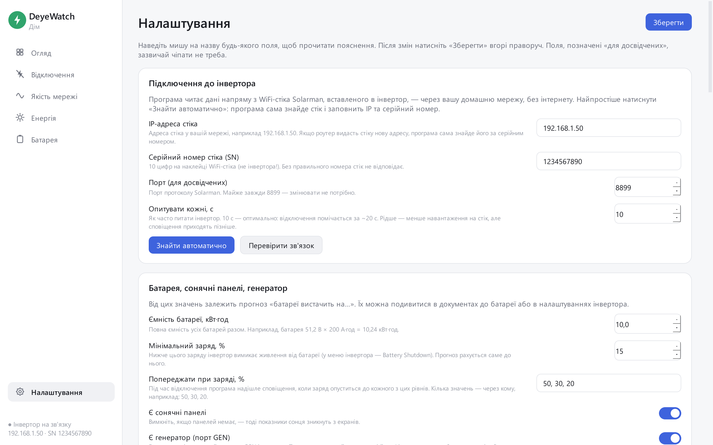

# Налаштування

[← До README](../README.md)

Усі параметри змінюються у вікні *Налаштування*. Під кожним полем є коротке пояснення.
Перемикачі й списки зберігаються одразу, числові та текстові поля — кнопкою **«Зберегти»** вгорі.
Поля з позначкою «для досвідчених» зазвичай змінювати не потрібно.

Файл налаштувань: `%APPDATA%\DeyeWatch\settings.json` (Windows) або `~/.config/deyewatch/settings.json`
(Linux). Іншу теку можна задати змінною середовища `DEYEWATCH_HOME`.

## Підключення до інвертора

| Параметр | Типово | Опис |
|---|---|---|
| IP-адреса стіка | — | Знаходиться автоматично. Якщо стік отримає нову адресу, програма знайде його за серійним номером. |
| Серійний номер стіка (SN) | — | 10 цифр на наклейці WiFi-стіка. Без правильного номера стік не відповідає. |
| Порт | 8899 | Порт протоколу Solarman V5. |
| Опитувати кожні, с | 10 | Як часто читати дані з інвертора. |

Кнопки: **«Знайти автоматично»** і **«Перевірити зв'язок»** (покаже напругу, заряд і споживання).

## Батарея, сонячні панелі, генератор

| Параметр | Типово | Опис |
|---|---|---|
| Ємність батареї, кВт·год | 10 | Повна ємність усіх батарей разом (напр., 51,2 В × 200 А·год = 10,24 кВт·год). |
| Мінімальний заряд, % | 15 | Заряд, на якому інвертор вимикає живлення від батареї (*Battery Shutdown*). Прогноз рахується до нього. |
| Попереджати при заряді, % | 50, 30, 20 | Пороги для сповіщень під час відключення. |
| Є сонячні панелі | так | Вимкніть, якщо панелей немає. |
| Є генератор (порт GEN) | ні | Вмикається само, щойно інвертор уперше побачить генератор. |
| Генератор працює, якщо дає понад, Вт | 30 | Поріг запуску генератора. |

## Як визначати відключення

| Параметр | Типово | Опис |
|---|---|---|
| Назва об'єкта | Дім | Підпис у сповіщеннях («Дім», «Дача»…). |
| Світла немає, якщо напруга нижче, В | 170 | Поріг напруги мережі. |
| Підтверджувати, опитувань | 2 | Захист від миттєвих «блимань»: зміна має повторитися N разів поспіль. |
| «Немає зв'язку» після, опитувань | 6 | Скільки невдалих опитувань поспіль до сповіщення про втрату зв'язку. |

## Якість мережі

| Параметр | Типово | Опис |
|---|---|---|
| Нижня межа норми, В | 207 | 230 В − 10 %. |
| Верхня межа норми, В | 253 | 230 В + 10 %. |
| Сповіщати, якщо триває, хв | 2 | Короткі стрибки не сповіщаються. |

## Сповіщення

Окремі перемикачі для кожного типу (див. [Посібник](user-guide.md#сповіщення)), а також:
показувати на цьому комп'ютері, звук, тривалість показу картки. Кнопки-приклади показують,
як виглядає кожне сповіщення.

## Telegram

Див. окремий розділ [Telegram](telegram.md).

## Хмара Deye Cloud

Див. окремий розділ [Deye Cloud](deye-cloud.md).

## Статистика та аналітика

| Параметр | Типово | Опис |
|---|---|---|
| Записувати історію показників | так | Без цього працюють лише сповіщення. |
| Розділи «Відключення», «Якість мережі», «Енергія», «Батарея» | так | Непотрібні можна сховати з меню. |
| Зберігати детальну історію, днів | 365 | Хвилинні записи старші за цей термін видаляються (рік ≈ 30 МБ). Підсумки по днях і журнал відключень зберігаються завжди. |

## Інтерфейс

| Параметр | Типово | Опис |
|---|---|---|
| Тема | Як у системі | Або світла / темна вручну. |
| Запускати разом із системою | ні | Див. [Автозапуск](installation.md#автозапуск). |
| Запускати згорнутим у трей | так | При автозапуску вікно не відкривається. |

Кнопка **«Показати „З чого почати“ на Огляді»** повертає картку першого налаштування.

## Перенесення на інший комп'ютер

*Налаштування → Перенесення налаштувань*:

- **«Зберегти у файл…»** — усі налаштування в один файл `.json`. Перемикач
  **«Разом із паролями й токенами»** додає токен Telegram, App Secret і хеш пароля Deye Cloud —
  тоді на новому комп'ютері все запрацює одразу.
- **«Завантажити з файлу…»** — показує, скільки налаштувань зміниться, і після підтвердження
  застосовує їх.

Файл підходить для Windows і Linux. Історія у файл не входить — на новому комп'ютері її догрузить
Deye Cloud.

> ⚠️ Файл із паролями й токенами — як ключ від ваших акаунтів. Не пересилайте його іншим,
> не додавайте в репозиторії й видаліть після перенесення.
