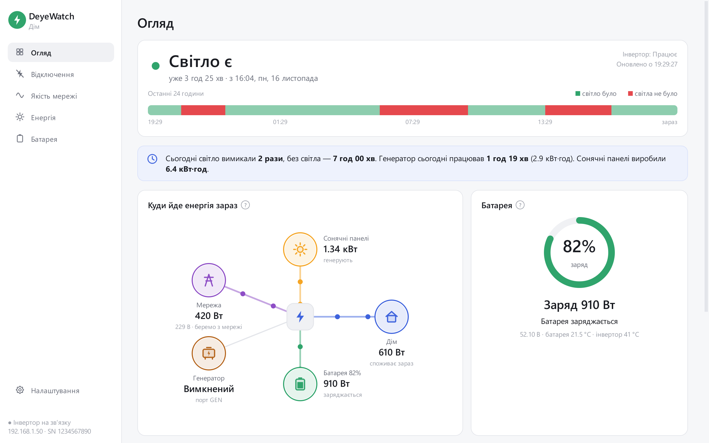
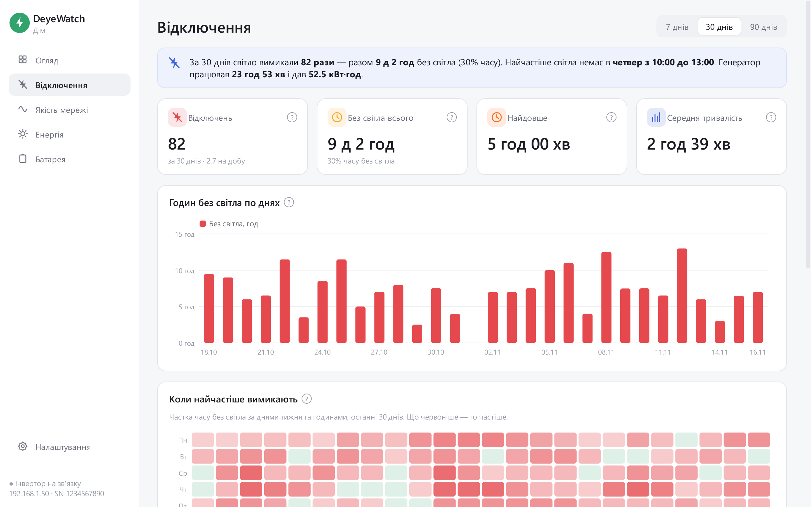
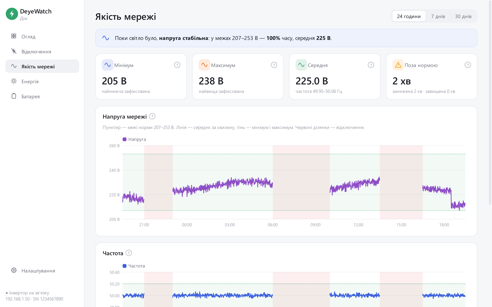
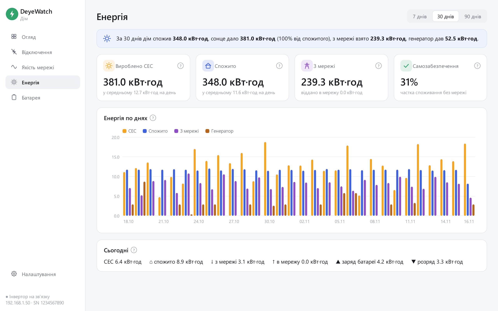
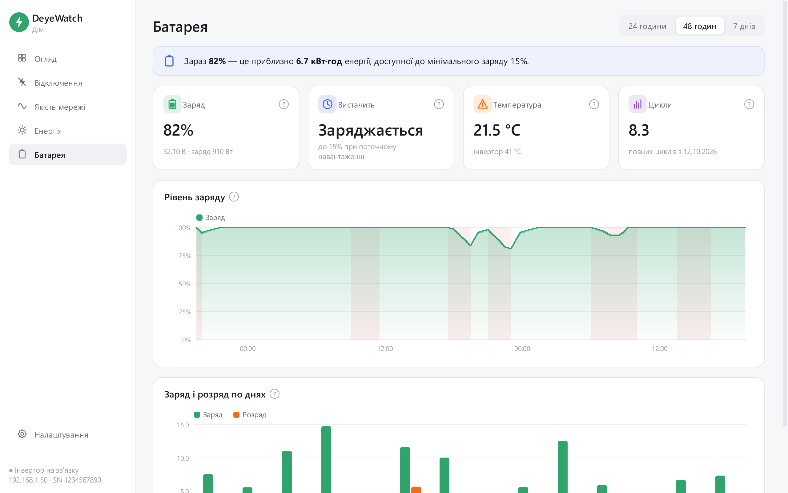
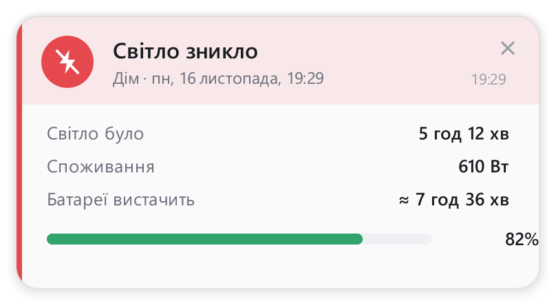
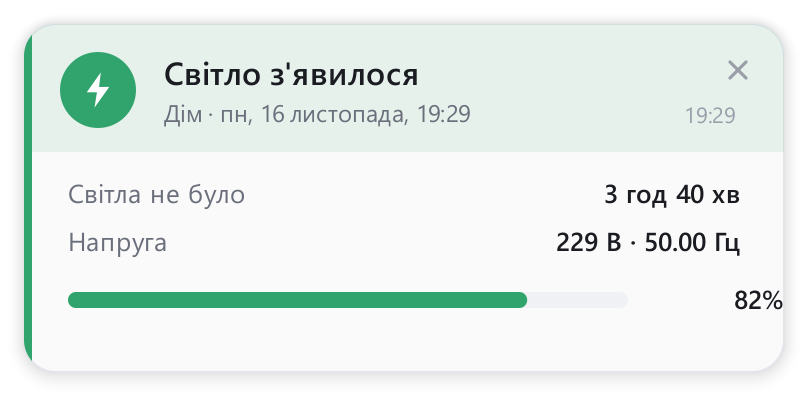
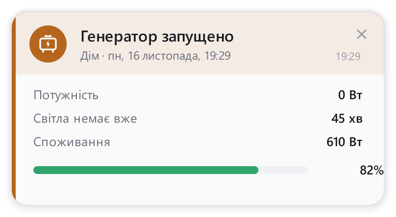

# Посібник користувача

[← До README](../README.md)

DeyeWatch працює у фоні: іконка біля годинника показує стан (зелена — світло є, червона — немає),
подвійний клік відкриває вікно. Закриття вікна лише ховає його в трей; повністю вийти —
*іконка в треї → «Вийти»*. Біля кожного показника є значок **?** — наведіть мишу, щоб прочитати пояснення.

- [Огляд](#огляд)
- [Відключення](#відключення)
- [Якість мережі](#якість-мережі)
- [Енергія](#енергія)
- [Батарея](#батарея)
- [Сповіщення](#сповіщення)
- [Генератор](#генератор)
- [Дані за час, коли програма не працювала](#дані-за-час-коли-програма-не-працювала)

## Огляд

- **Стан зараз** — «Світло є» або «Світла немає», скільки триває і з якого часу.
  Праворуч — режим роботи інвертора й час останніх даних.
- **Останні 24 години** — смуга: зелене — світло було, червоне — не було.
- **Підсумок дня** — одним реченням: скільки разів вимикали, скільки часу без світла,
  скільки вистачить батареї або скільки виробило сонце.
- **Куди йде енергія зараз** — схема: сонячні панелі, мережа, генератор і батарея з'єднані з
  інвертором у центрі, а він живить дім. Точки рухаються в напрямку потоку (швидше — більша потужність),
  сіра лінія — потоку немає, червоний пунктир до мережі — світла немає.
- **Батарея** — заряд, потужність заряду/розряду та прогноз «Вистачить ≈ … до 15 % при поточному
  споживанні». Під час заряджання прогноз не показується.
- **Потужність за 24 години** — споживання, сонце, мережа й генератор; червоні ділянки — відключення.
  Наведіть мишу на графік, щоб побачити точні значення.

## Відключення

Період — 7, 30 або 90 днів (перемикач угорі праворуч).

- **Підсумок**: скільки разів вимикали, скільки часу без світла, у який день і години відключення
  найчастіші; якщо є генератор — скільки він працював і скільки енергії дав.
- **Плитки**: кількість, сумарний час без світла (і частка від усього часу), найдовше й середнє
  відключення. Короткі «блимання» до 2 хвилин не рахуються.
- **Годин без світла по днях** — стовпчик на кожен день.
- **Коли найчастіше вимикають** — теплова карта: рядки — дні тижня, стовпці — години.
  Що червоніша клітинка, то частіше в цей час немає світла.
- **Останні відключення** — повний журнал: початок, кінець, тривалість.

## Якість мережі

Рахується лише за час, коли світло було.

- **Мінімум / максимум / середня** напруга та діапазон частоти.
- **Поза нормою** — скільки часу напруга була нижчою або вищою за межі норми
  (типово 207–253 В, тобто 230 В ±10 %).
- **Графік напруги**: лінія — середнє за хвилину, тінь — мінімум і максимум, пунктир — межі норми.
- **Частота** (норма — 50 Гц) і **журнал подій**: тривала занижена/завищена напруга, втрата зв'язку.

## Енергія

Вироблено сонцем, спожито домом, взято з мережі й віддано в неї, енергія від генератора — за 7, 30
або 90 днів, а також **самозабезпечення**: яку частку споживання покрили власні сонце й батарея.
Блок «Сьогодні» — лічильники інвертора з початку доби.

## Батарея

Заряд і напруга, прогноз роботи, температура батареї та інвертора, кількість **повних циклів**
(сумарний розряд ÷ ємність), крива заряду з відключеннями та заряд/розряд по днях.

## Сповіщення

| Сповіщення | Коли |
|---|---|
| **Світло зникло** | Напруга мережі нижча за поріг у 2 опитуваннях поспіль (~10–20 с після події). Висить, доки ви його не закриєте. |
| **Світло з'явилося** | З тривалістю відключення, напругою й частотою. |
| **Низький заряд батареї** | Під час відключення — при досягненні кожного з порогів (типово 50, 30, 20 %). |
| **Напруга поза нормою** | Коли світло є, а напруга довше 2 хв нижча або вища за межі норми. |
| **Генератор запущено / зупинено** | Із потужністю, часом роботи й виробленою енергією. |
| **Немає зв'язку з інвертором** | Стік не відповідає 6 опитувань поспіль (~1 хв); і коли зв'язок повернувся. |
| **Підсумок дня** | О 21:00 (вимкнено за замовчуванням). |

Сповіщення з'являються в правому нижньому куті екрана; наведіть на картку мишу — вона не зникне,
клікніть — відкриється вікно програми. Ті самі сповіщення можна отримувати в
[Telegram](telegram.md). Кожен тип вмикається окремо в *Налаштування → Сповіщення*, там же є
кнопки-приклади.

## Генератор

Якщо генератор підключено до порту **GEN** інвертора, DeyeWatch вмикає його підтримку сама —
щойно інвертор уперше покаже потужність на цьому порту. Тоді генератор з'являється на схемі потоків
і графіках, у шапці пишеться «Світла немає · працює генератор», рахуються час роботи та енергія.
Поріг, від якого генератор вважається запущеним (типово 30 Вт), змінюється в налаштуваннях.

> Генератор, підключений замість мережі до входу **GRID**, інвертор не відрізняє від мережі —
> у такому разі програма вважатиме, що світло з'явилося.

## Дані за час, коли програма не працювала

Поки програма запущена, вона записує показники щохвилини. Коли комп'ютер вимкнений або спить,
нові дані з'явитися не можуть — на графіках буде розрив. Заповнити його можна з
[Deye Cloud](deye-cloud.md): інвертор сам відправляє дані в хмару, і DeyeWatch догружає пропущене
при запуску, після сну, при відновленні зв'язку та кожні 30 хвилин. Свіжі пропуски з'являються в
хмарі із затримкою 5–15 хвилин — програма повторить спробу через 10 хвилин.
